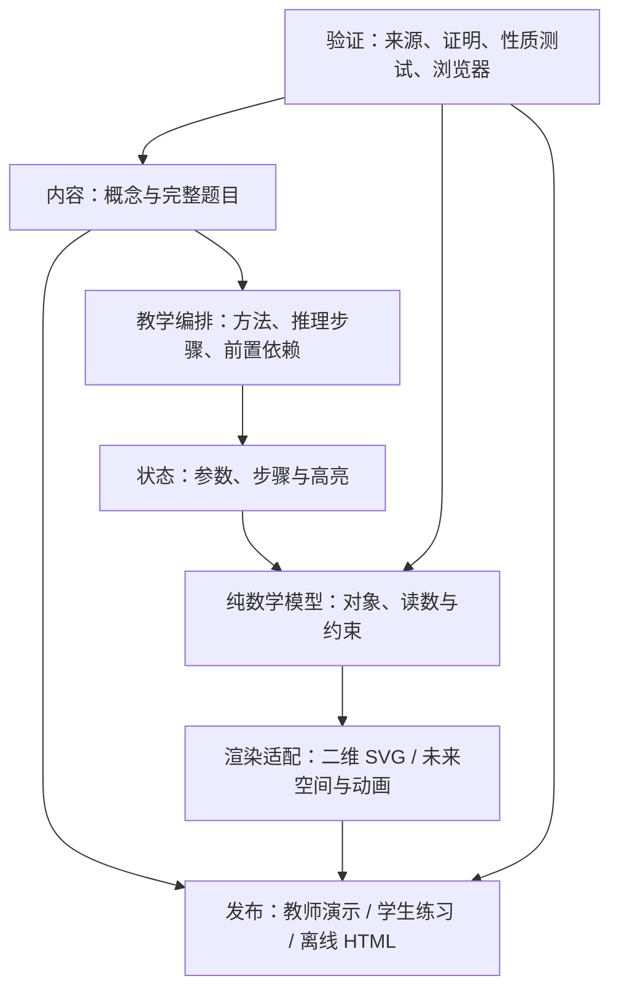

# 从圆锥曲线实验到高中数学讲解框架

目标是让教师以同一种创作流程编写概念、性质与难题解析：先核对数学，再绑定可操作对象，最后生成可离线分享的讲解页。v0.1使用一个模块化TypeScript项目；只有实际出现独立发布需求才拆npm包，避免从一开始维护多套构建和版本。

## 六层边界

| 层 | 本版位置 | 职责与边界 |
| --- | --- | --- |
| 内容契约 | `src/core/schema.ts` | 版本、知识主题、完整题干、来源/许可、前置知识、教学路径。内容不能执行脚本。 |
| 教学路径 | `src/content` | 每步写明主张、动机、依据和依赖，可绑定状态预设与图形高亮。跨步依赖不等于自动证明。 |
| 状态 | `src/core/state.ts` | 参数校验、版本化分享链接、范围收敛；模型不读DOM或地址栏。 |
| 数学模型 | `src/math` | 纯输入输出；统一返回有效/退化/空集状态、图形对象、读数和约束检查，不在视图重复算数学。 |
| 渲染 | `src/renderers` | 二维SVG按真实坐标比例绘制；只消费Scene，不写题目结论。其他可视化作为新适配器加入。 |
| 发布 | `scripts/export.ts`、Vite | 本地演示与教师单文件；学生练习从白名单数据重新生成，不靠折叠/CSS隐藏答案。 |

## 两条创作路径

**知识讲解**：学习目标 → 前置知识 → 选择自由变量 → 观察对象与不变量 → 反例/退化/定义域 → 高中证明 → 迁移。不是所有段落都必须可视化；图形必须解释一个明确关系。首个新例是二次函数的判别式、顶点高度与根的个数，同一模型联动三个量。

**难题解析**：完整题干和来源 → 子问题/目标 → 条件到方法的桥梁 → 一步一个推理动作 → 可行域与分类 → 结论及逆向验证 → 方法比较。例题使用自编抛物线弦中点问题，分别以点差法和韦达定理证明，再用交点存在性排除边界；不是在动画旁贴一段答案。

每个推理节点有稳定id、`dependsOn`、数学文本、场景预设与高亮id。内容校验检查引用和无环，但不声称能机器验证证明。v0.1通过有序步骤导航呈现，后续可增加分支展开；计算机代数只能作为复核工具，不能代替高中推理。

## 模型与场景契约

教师选择一个已注册的可信模型；模型参数由注册表声明。正文只引用modelId、有限数值与稳定对象id，不支持`eval`、远程脚本或字符串表达式求值。新增题目若已有模型可只加内容；新增数学关系必须实现模型、条件与性质测试。

`Scene`包含视窗、曲线/线段/点、读数、有效性状态和约束说明。图形和读数都从同一计算结果来。有限画幅不代表定义域有限。参数导致空集或退化时先返回明确状态，渲染器不画一条假的普通曲线。支持负数、零、端点及失效条件，不将非法参数自动伪装为有效数学对象。

## 现有24入口怎样接入

`legacy/`保留现有三个八入口页面及其可移植构建：只使用仓库内资源与npm安装的KaTeX。旧实验经过独立数学和浏览器验收，先保留功能，再按构造族逐个迁移到Scene。v0.1没有声称24个入口都已改成新契约。

Anatomy是适合真实机构的可选渲染方式，保留原拉绳仪与MIT版权；不会强迫函数、概率、数列都变成机械图。原仪器以包含内联源码的已验收HTML快照作为可再分发资产；重建普通三曲线网页无需安装Codex skill。

## 学科扩展

| 方向 | 可复用对象 | 先验证的边界 |
| --- | --- | --- |
| 函数与导数 | 图像、切线、根、区间、参数族 | 定义域、端点、分段与不可导点 |
| 三角与向量 | 单位圆、投影、角、基向量 | 有向角、符号、退化向量 |
| 数列与不等式 | 离散点、部分和、可行域 | 整数指标、等号与取值范围 |
| 立体几何 | 点线面、截面、距离与投影 | 真实长度、遮挡、投影失真 |
| 概率统计 | 样本空间、树、随机过程、分布 | 种子、样本偏差；频率不是概率证明 |
| 综合难题 | 多模型场景、推理依赖与分类 | 非等价变形、增漏解、存在性 |

## 数据、AI与隐私

内容源与教学原始材料分开。公开仓库仅放自编/明确可再分发示例，来源字段不代表获得版权。真实试卷与学生材料默认留在本地项目外，OCR、题库或课堂反馈通过未来导入适配器读本地副本；没有上传接口或账号系统。教师人工审阅来源、题干、证明及发布许可后才进入公开目录。

AI未来只生成待校验的结构化草稿，流水线是“来源核对 → 内容契约 → 数学复核 → 图形与读数一致性 → 桌面/手机/离线 → 人工内容发布”。格式校验和数值抽样不能升级为数学正确性证明；仓库公开也不自动公开本机题库。

## 演进次序与验收

1. **v0.1 / 本版**：旧24入口可重建；通用内容/模型/渲染边界；跨主题概念例和双解法问题例；教师/学生离线导出；CI与独立复核。发布之前真实安装、构建、浏览器验收。
2. **v0.2**：把两三个圆锥曲线构造迁入统一Scene，完善课堂显示与多场景步骤。验收以“教师仅写内容即可复用模型、导出的学生文件无答案数据”为准。
3. **v0.3**：Markdown创作适配、知识前置关系与变式关联。先用10个不同主题验证内容契约；发现不适配再改，不批量灌库。
4. **v0.4**：空间几何、离散过程与分支题解。按真实题目引入Three.js/动画或CAS复核适配，不先建设通用拖拽编辑器。
5. **以后**：本地备课工作台、AI草稿、题库导入、打印/视频出口。只有出现多人协作/同步需求再考虑后端、数据库与权限系统。

当前优先把一条可迁移的“正确内容 → 可信模型 → 可教学交互 → 可分享成品”链路做稳。全自动解难题、知识图谱平台和在线多人编辑都不列为本版能力。
